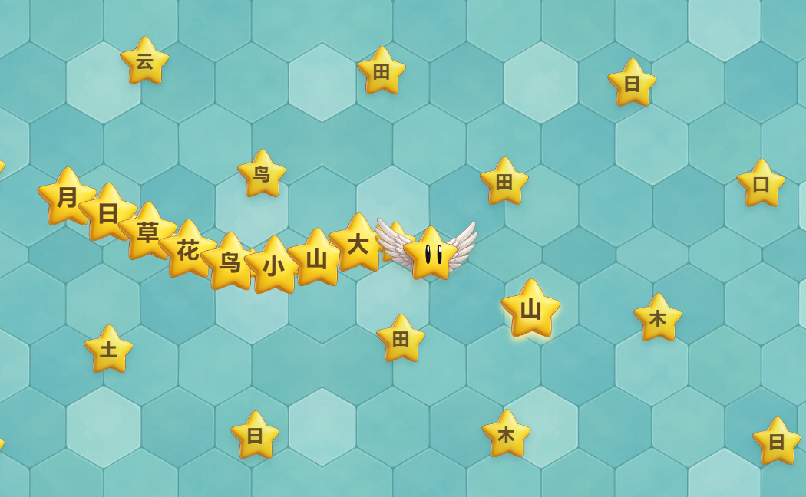

# 小飞星 · 星星蛇

可运行的角色拼装与增长小样：独立小飞星头部、连成身体的金色星星、运行时绘制的汉字。蓝绿色方形大地图参考此前 Snake.io 截图的清爽卡通方向。

## 运行

在本目录启动静态服务（需要 Python）：

```powershell
python scripts/serve.py --port 5188 --bind 127.0.0.1
```

打开 http://127.0.0.1:5188/ 。页面默认自动演示。点击“开始操控”后，方向键 / WASD 指定方向，同时按两个方向可斜走；Q / E 按住连续向左 / 右绕弯，松开后沿当前朝向前进。按住场地拖动可做 360° 任意转向；手机用方向按钮或拖动。空格暂停，再按继续。地图只出现当前目标汉字，碰到后获得 1 星积分；身体靠吃病毒积累成长值增加。

首次点击或按键操作后会播放轻柔循环背景音乐。认对字、吃病毒、长身体、圈住超级病毒和受伤有不同音效；点击游戏下方的「声音开 / 声音关」按钮可随时切换。认对字时，现有金色星星素材会从汉字所在位置向四周散落约一秒。声音偏好保存在当前浏览器。

支持微软 / Xbox 手柄。连接后，在前台游戏页按一下手柄按键，页面会显示连接状态。左、右摇杆都可做 360° 方向控制（左摇杆优先），十字方向键可组合斜走；ABXY 按实际位置对应 Y 向上、A 向下、X 向左、B 向右。菜单键 / Start 暂停与继续，只在按下时触发一次。松开方向后保持当前朝向前进，速度仍由移动参数控制。

摇杆默认死区为 0.2，可在参数面板「手柄」一组调节，用来过滤漂移。手柄、键盘、拖动可切换；正在使用手柄时，即使浏览器窗口短暂失焦，只要游戏页仍可见就继续接收手柄方向，避免误暂停。切到隐藏页面会暂停；手柄连续约 1.2 秒无法读取才按断连暂停，短暂漏读不会打断游戏。编辑参数时不接收手柄控制。暂停后要让摇杆回中再继续转向。使用标准 Gamepad 布局或 Xbox / XInput 设备；未知布局会明确提示。

目标字右侧的「全屏游玩」会放大整个游戏区域，保留目标字、暂停与方向说明。再次点击或按 Esc 退出。浏览器未开放原生全屏时使用铺满网页的模式，退出同样恢复原布局。地图和视野会随画布大小重新适配。

运行上述服务后，页面每 2 秒检查一次游戏版本，返回页面时也会立即检查。修改页面、样式、游戏代码或素材后，服务自动计算内容构建号。标题下显示完整版本格式 `v0.2.9+构建号前八位`；其中 `0.2.9` 来自 `package.json`，构建号随游戏内容自动变化。确认新版稳定后，旧页面会直接显示「游戏有更新」小窗，列出新版本号，全屏内也能看到，无须手动刷新。点击「立即更新」加载新版，保留本机参数，本局重新开始；点击「稍后再说」可继续游戏，稍后从下方「有更新」按钮重新打开。

自动更新依赖 `scripts/serve.py` 的 `/version.json` 接口；普通 `python -m http.server` 仅可运行游戏，不能自动检测更新。服务暂时离线时仍可继续玩，检测会在服务恢复后重试。每次修改游戏后，交付回复应注明页面显示的当前版本号。

地图默认是一张 12,800 × 12,800 的大方形场地。可在「游戏参数 → 地图 → 地图边长」调整为 3,200–25,600 单位，立即生效；下次打开会沿用保存的尺寸。小飞星从中央出发，相机持续跟随，右下角的小地图显示当前位置和当前视野。自动演示会在外缘向内转；手动操控可顶住真正的边界，但会持续受伤。食物随探索位置分区加载。

当前用于确认角色和操作手感，尚未接入组词关卡、存档或学习评估；玩家身体不与自身碰撞，但可以用来圈吃超级病毒。

## 碰撞与受伤

手动操控时持续朝地图边界前进，头部会停在边界内侧，每隔默认 1 秒受伤一次；转向内侧便停止。直接碰到超级病毒，或碰到游走病毒蛇的头部和身体，也按相同间隔受伤。每次从尾部失去最多两节星星，头部与整条身体快速闪烁约 0.8 秒；没有尾巴时头部仍能移动、受伤并闪烁，之后吃病毒还能重新长出身体。普通大病毒仍可直接吃，默认提供 +5 成长。

敌方病毒蛇的**头部从外侧进入我方身体**时会立即死亡，原位置散出 6–10 颗小、中、大病毒，和地图上的普通病毒一样可以被吃掉、结算成长。敌蛇头撞我方头时仍是我方受伤。死亡的敌蛇约 8 秒后在玩家附近重新出现，保证地图仍有游走对手。

地图上的小、中、大、超级病毒固定在出生点，各自以不同节奏轻轻摆动；暂停或将速度设为 0 时动画会停住。「游戏参数 → 病毒与成长 → 病毒原地摆动速度」可即时调整，默认 22，范围 0–80。病毒蛇的数量与移动速度单独设置；数量默认 5 条，可调 0–20 条，改动即时生效并保存。

小病毒使用 `assets/virus-small-v4.png`：圆球主体配贴边小鼓包，没有细长触角。中病毒使用 `assets/virus-medium-v4.png`：回到 v2 的大圆主体和原有六个鼓包，只稍微向外延长。旧图保留作对照；角色美术仍是位图素材，运行时只负责摆放和缩放。认对字后不再弹出文字提示，积分、星星散落和音效继续反馈。

地图上的小、中、大、超级病毒直径分别为 52、84、144、288 游戏单位。超级病毒的碰撞、汉字避让与圈吃判定随新尺寸同步变化。每档病毒随机出现紫、蓝、薄荷绿、珊瑚色四种颜色，病毒蛇也按个体随机选色。颜色图在 `docs/virus-palette-preview-v1.png`；`scripts/recolor-virus-assets.py` 只给已有美术换色，保留原有形状、光影、脸部细节和透明边缘。

受伤间隔可在「游戏参数 → 碰撞与受伤」调整为 0.25–3 秒并保存。圈住超级病毒后才结算 +30 成长；绕外侧形成有效闭环不会因为圈吃动作本身受伤。

## 实时调整移动参数

点击右上角「游戏参数」，可拖动滑块或直接输入数值。改动即时生效，不需要刷新或重新开局；全部参数保存在当前浏览器，下次打开自动恢复。重新开始只重置队伍和位置。

可调内容包括：

- 移动与转向：前进速度、最大转向速度、最小转弯半径、Q / E 连续转向速度、方向对准速度、转向响应、拖动死区。
- 手柄：摇杆死区。
- 镜头与显示：镜头跟随速度、画面缩放、头部宽度、转弯倾斜、上下浮动。
- 身体与模拟：星星中心间距、头部与首字距离、身体星星大小、移动更新频率。
- 病毒与成长：四档病毒成长值、每节成长门槛、圈吃闭合容差、病毒原地摆动速度。
- 病毒蛇：数量、移动速度。
- 碰撞与受伤：持续受伤间隔。

项目默认采用 2026-10-22 用户在 ego lite 中保存的参数：速度 201、最大转向速度 1000、最小转弯半径 20、Q / E 转向速度 180、方向对准速度 50、转向响应 120、拖动死区 6、镜头跟随 12、缩放 1、头部宽度 128、倾斜幅度 4、浮动 1.5、星星间距 16、头部与首字距离 50、身体大小 74、更新频率 120。

基础移动默认值沿用上述用户设置，另增加摇杆死区 0.2。预设「灵敏」的弯道半径为 24；「顺滑」为 48，适合对照较宽圆弧；「旧版对照」恢复早期较慢的转向手感。恢复默认会重置全部参数，预设只修改移动和镜头手感，保留身体大小等设置。

面板下方可以复制或导入 JSON，方便保存、对比或分享参数。默认值、范围、单位和字段说明集中在 `src/config.js`。移动步长等于前进速度除以移动更新频率，面板实时显示该数值。

移动没有网格吸附。早期按键只指定四个正方向，加上弯道半径很小，身体看起来像直角折线；现在方向键可组合，Q / E 和拖动支持连续方向。当前默认最小转弯半径为用户选定的 20 单位；设为 0 可对照此前的小弯效果。半径越大，转完整个弯需要的时间和空间也越多，转向响应参数仍独立控制按键后的起步反应。Q / E 的稳定转向会形成圆形中心轨迹，实际半径还受前进速度和转向速度影响；拖动追逐指针不保证固定圆心或固定半径。调参面板可通过 URL 参数 `?tuning=1` 自动展开。

## 角色如何拼装

### 病毒成长与认字积分（2026-10-23）

小、中、大病毒显示大小分别为 36 / 52 / 72 单位，默认提供 +1 / +3 / +5 成长值；每 10 点增长一节身体，超出点数保留。例如 9 点吃到大病毒，长一节后留下 4 点。吃对目标字只获得 1 星积分，不增加身体长度；左上角使用与蛇身相同的星星图片显示积分。

「游戏参数」的「病毒与成长」支持保存四项数值：`smallVirusValue`、`mediumVirusValue`、`largeVirusValue`、`growthPerSegment`。全部是正整数；修改后地图标签、图例和成长条立即更新。调低门槛时会按新门槛结算已有剩余点数，不会缩短已有身体。旧版移动配置自动补充四项默认值，保留原手感。重新开始会清空本局积分、认字记录和剩余成长，但保留设置。

病毒精灵 `assets/virus-purple-v1.png` 裁切自已有 AI 原图，保留原生透明通道；`scripts/build-virus-assets.py` 仅裁切与缩放，不绘制美术。`src/rewards.js` 将成长和识字奖励分开处理，`VirusField` 分区加载附近三档病毒。自动演示会交替寻找病毒与目标字。

- `assets/flystar-head-v1.png`：小飞星的透明头部，合成自已有的翅膀、金色身体、眼睛四层，未使用脚部层。
- `assets/hanzi-star-v2.png`：由已有金色星体图层裁切而成的透明身体图片。每颗星星复用它，中文通过 Canvas 文字绘制，所以能自由替换、增长。
- `assets/arena-floor-v2.jpg`：可连续铺设的蓝绿色地图底纹。
- `src/trail.js`：记录头部走过的路线，按沿线距离放置身体；每节间距固定，汉字始终正立。绘制时与头部沿相同路线插值。
- `src/motion.js`：转向速度渐变；物理更新默认以 120Hz 固定步长运行（可调），绘制在相邻更新之间插值，减少拐弯和低帧率时的跳动。
- `src/steering.js`：组合方向、连续绕弯及按键状态；暂停、失焦和切换输入时清除按住状态。
- `src/gamepad.js`：摇杆死区、十字键与 ABXY 映射、多设备选择、菜单键按下检测。
- `src/fullscreen.js`：原生全屏、网页铺满后备方案和退出恢复。
- `src/updates.js`、`scripts/serve.py`：自动版本检测、稳定版本确认、全屏内提示、一键加载新版。
- `src/config.js`、`src/tuning.js`：默认参数、预设、校验和本机保存，以及实时调参面板。
- `src/world.js`：大方形地图、边缘引导、附近食物分区加载与回收。
- `src/game.js`：控制移动、吃字、相机、独立素材绘制与输入。
- `assets/sprites.json`：尺寸与头部中心锚点。

## 素材来源与复现

小飞星原图层复制到 `assets/source/flystar/`，原项目未被修改。
星星身体直接使用 `assets/source/flystar/Part_02.png`，没有用程序绘制角色美术。
新版地图底纹使用 imagegen 技能的 `image_gen.py` CLI，模型 `gpt-image-2`，medium，1024×1024，经用户批准的 API 接口生成。通过镜像拼接保证重复边缘衔接。原图及提示词：

- `assets/source/arena-floor-v2.png`
- `assets/source/arena-floor-v2.prompt.txt`

首版草地、方形字块和生成记录仍保留在素材目录，供对比。

API 只用于离线生成素材。网页运行无需 API Key，也不调用生成服务。密钥未写入项目。

重新合成透明素材（Python + Pillow）：

```powershell
python scripts/build-star-assets.py
```

无需重新生成图片。原小飞星头部的图层合成工具为 `scripts/build-assets.py`。

## 检查

Node.js 运行 `npm test` 和 `npm run check`。测试覆盖转弯、尾部增长、帧率独立取样、暂停、角度跨界、路线裁剪、转向加速度、绘制插值、大地图坐标和食物加载回收。

2026-10-21 新版验证：12 项路线、移动和地图测试通过；ego-browser 中实际吃字增长、手动转向、暂停恢复通过；角色已实际走到 x > 2,100，越过旧场地范围后相机与食物继续跟随；390px 手机视口无横向溢出，方向按钮可操作。

2026-10-22 调参版验证：17 项测试通过；浏览器中实际移动速度与设置值一致，零速度可原地转向；实时调整、刷新保留、预设、JSON 导入和格式校验通过。

2026-10-22 连续转向验证：21 项测试及 7 个模块语法检查通过；ego-browser 中验证了组合斜走、Q / E 连续绕弯及松键停止、暂停清除按键、转弯半径刷新保留。拖动实测朝向约 26.3°，没有吸附到固定方向；弯道画面中头部与汉字身体沿同一路径跟随。390px 视口无横向溢出。

2026-10-22 手柄与全屏验证：26 项测试通过。ego lite 实际检测到 `Xbox 360 Controller (XInput STANDARD GAMEPAD)`，静止摇杆漂移被死区过滤；使用临时模拟 Gamepad 输入验证了完整游戏循环中的任意角度摇杆、ABXY、十字键、键盘接管、菜单键按下/按住及断开暂停，测试结束恢复原接口。原生全屏按钮进出、Esc 退出及网页铺满后备方案通过；原生全屏画布达到 2518 × 1115，390px 视口无横向溢出。实体手柄连接已确认，实体按键与摇杆手感仍由用户试玩确认。

2026-10-22 更新提示验证：29 项 JS 测试和 1 项服务版本测试通过。真实修改游戏文件后，全屏内自动出现更新小窗；稍后再说、重新打开、立即更新通过，URL 与页面版本同步变化，更新前后 17 项配置一致。首次加载和更新成功后没有多余提示。

2026-10-23 版本展示验证：页面从 `v0.2.0+cf9b7be5` 开始，修改游戏文件后旧页无需手动刷新即显示「发现 v0.2.0+a9803095」；点击「立即更新」后页面标签与接口构建号同步，提示窗消失。版本检查间隔改为 2 秒。52 项 JS 测试、1 项服务版本测试及全部 14 个 JS 模块语法检查通过。

2026-10-23 病毒分档验证（早期版本）：34 项 JS 测试和全部模块语法检查通过。ego lite 实际游玩验证了吃病毒累积成长、8 点吃 +5 后长一节并保留 3 点、吃字只加星星积分；将门槛从 10 调至 5 后，7 点结算为一节并留下 2 点。三档数值修改为 2 / 4 / 8 后，图例立即更新且刷新保留，原 17 项移动设置保持一致。验证后恢复 1 / 3 / 5、门槛 10。当时原生全屏能显示成长条和积分，390px 视口无横向溢出。新增本机配置四个数字字段，不增加运行时 API 或后端存储；新增病毒 PNG 约 282 KiB。实际画面见 `docs/virus-growth-preview-v1.png` 与 `docs/virus-growth-mobile-v1.png`。

实际程序运行画面：


