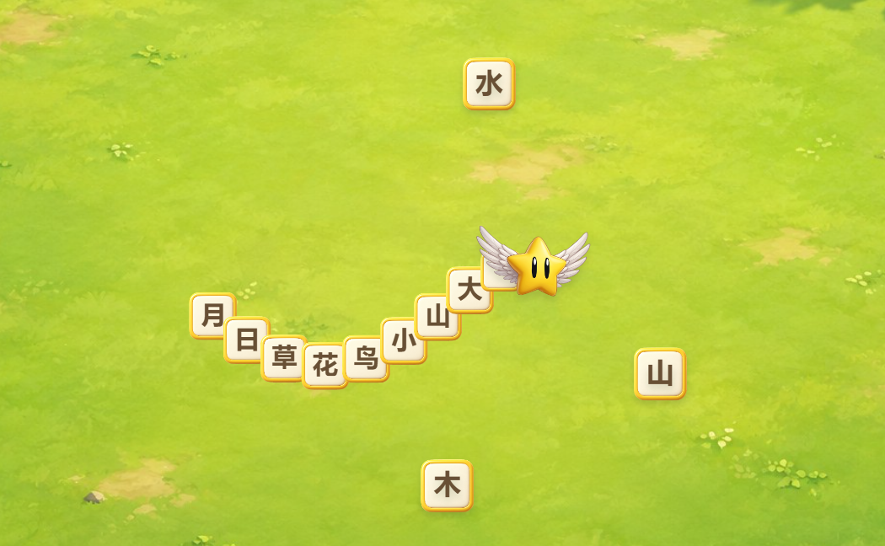

# 小飞星 · 汉字长龙

可运行的角色拼装与增长小样：独立小飞星头部、可复用的身体图片、运行时绘制的汉字。

## 运行

在本目录启动静态服务（需要 Python）：

```powershell
python -m http.server 5188 --bind 127.0.0.1
```

打开 http://127.0.0.1:5188/ 。页面默认自动演示。点击“开始操控”后，方向键 / WASD 转向，或按住场地拖动；手机用方向按钮或拖动。空格暂停，再按继续。找到上方的目标字，碰到后在尾部新增一节；碰到其他字会提示重找。

当前用于确认角色和操作手感，尚未接入组词关卡、存档或学习评估。边缘会柔和转向场内，身体不判碰撞。“本次收集”仅表示吃到的数量。

## 角色如何拼装

- `assets/flystar-head-v1.png`：小飞星的透明头部，合成自已有的翅膀、金色身体、眼睛四层，未使用脚部层。
- `assets/hanzi-segment-v1.png`：一张无字透明身体素材。身体的每一节复用它，中文通过 Canvas 文字绘制，所以能自由替换、增长。
- `src/trail.js`：记录头部走过的路线，按沿线距离放置身体；每节间距固定，汉字始终正立。
- `src/game.js`：控制移动、吃字、相机、独立素材绘制与输入。
- `assets/sprites.json`：尺寸与头部中心锚点。

## 素材来源与复现

小飞星原图层复制到 `assets/source/flystar/`，原项目未被修改。
草地图由此前生成的场景图转换，运行素材保存在 `assets/meadow-v1.jpg`。
空白身体素材使用 imagegen 技能的 `image_gen.py` CLI，模型 `gpt-image-2`，medium，1024×1024，经用户批准的 API 接口生成。原始图片及完整提示词分别在：

- `assets/source/hanzi-segment-v1.png`
- `assets/source/hanzi-segment-v1.prompt.txt`

API 只用于离线生成素材。网页运行无需 API Key，也不调用生成服务。密钥未写入项目。

重新合成透明素材（Python + Pillow）：

```powershell
python scripts/build-assets.py --segment-source assets/source/hanzi-segment-v1.png
```

无需重新生成图片；不传 `--segment-source` 时保留已合成的身体图片。

## 检查

Node.js 运行 `npm test` 和 `npm run check`。路线测试覆盖转弯、尾部增长、帧率独立取样、暂停、角度跨界与长时间路线裁剪。

2026-10-21 验证：6 项路线测试通过；ego-browser 中实际吃字增长、手动转向、暂停恢复、重置通过；390px 手机视口无横向溢出，方向按钮可操作。

实际程序运行画面：


