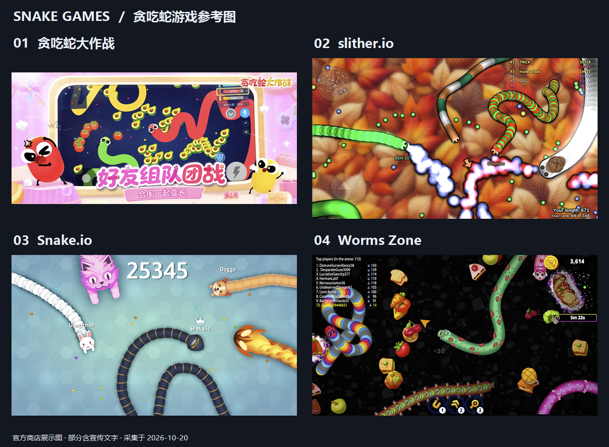
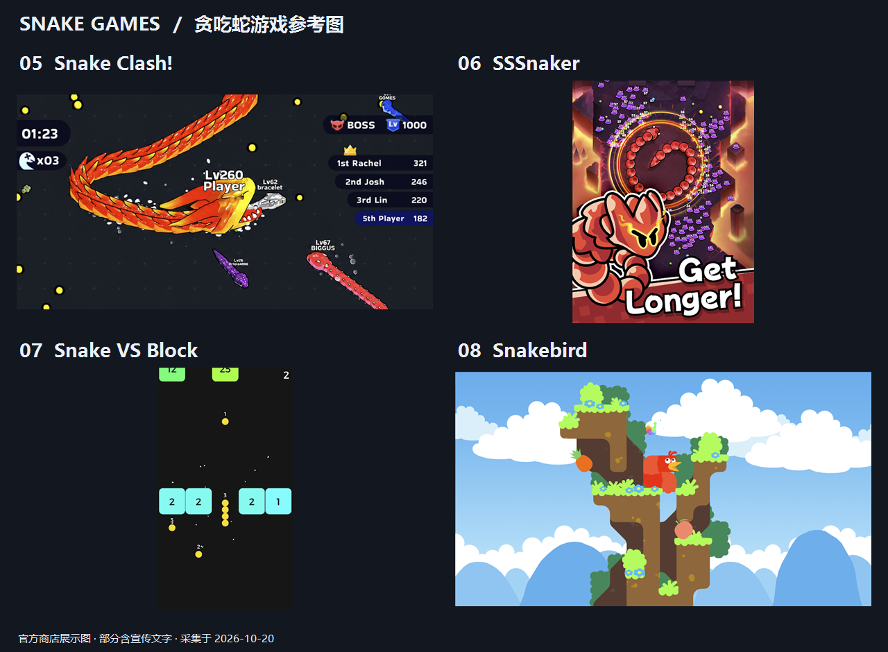

# 贪吃蛇类游戏调研与截图

查询日期：2026-10-20。使用 ego-browser 查询游戏官网、App Store、Google Play、TapTap 和 Steam 搜索结果。

本次整理 20 款游戏及独立发行版本，覆盖经典复刻、竞技、合成养成、射击、数字闯关和蛇身解谜。全球应用商店、小游戏平台和独立作品没有统一完整目录，因此这是一份有来源的代表作品清单，不能视为“市面上全部游戏”。平台栏列出本次查到的入口，不代表完整平台支持列表；地区上架状态可能不同。

## 游戏清单

| 序号 | 游戏与来源 | 已查到的入口 | 核心玩法与参考点 |
|---|---|---|---|
| 1 | [Snake '97](https://snake97.com/) | 网页、手机、Windows、Mac | 复刻老式手机点阵屏、按键与音效，参考经典操作和极简反馈。 |
| 2 | [贪吃蛇大作战](https://www.tcsdzz.com/) | 官网、[App Store](https://apps.apple.com/cn/app/id1120536875)、[TapTap](https://www.taptap.cn/app/13910) | 吃豆变长、加速截杀，无尽、限时、团战；卡通皮肤和社交玩法。 |
| 3 | [slither.io](http://slither.io/) | 网页、[Google Play](https://play.google.com/store/apps/details?id=air.com.hypah.io.slither) | 蛇头撞对方身体后淘汰，小蛇也能截杀大蛇；典型的自由转向竞技。 |
| 4 | [Snake.io](https://snake.io/) | 网页、[Google Play](https://play.google.com/store/apps/details?id=com.amelosinteractive.snake) | 吃食成长、排行榜、活动与主题皮肤；适合参考移动端竞技界面。 |
| 5 | [Worms Zone](https://worms.zone/) | 网页、Android、Apple 设备 | 食物、药水、皮肤和竞技场；重点是密集食物反馈和临时能力。 |
| 6 | [Wormate.io](https://wormate.io/) | 网页、iOS、Android | 糖果甜点主题、成长药水和皮肤，偏轻松鲜艳的视觉表达。 |
| 7 | [Little Big Snake](https://littlebigsnake.com/) | 网页、手机 | 蛇身竞技加入任务、技能成长、宠物；失败后还有飞虫玩法。 |
| 8 | [Snake Rivals](https://play.google.com/store/apps/details?id=com.supersolid.snake) | Google Play、[App Store](https://apps.apple.com/lu/app/id1440185894) | 3D 卡通风格的蛇身竞技，可参考立体角色和多人场景表现。 |
| 9 | [Gulper.io](https://gulper.io/) | 网页 | 霓虹光效、发光能量点、蛇身竞技，视觉接近光轨竞速风格。 |
| 10 | [Powerline.io](https://powerline.io/) | 网页、[Google Play](https://play.google.com/store/apps/details?id=com.profusionstudios.powerlineio) | 以电线/光轨代替蛇身，靠近对手产生收益，强调贴身走位。 |
| 11 | [贪吃蛇在线](https://www.taptap.cn/app/34281) | TapTap | 吞吃光点、引诱蛇头碰撞、以小搏大的竞技路线。 |
| 12 | [贪吃蛇乐园](https://apps.apple.com/cn/app/id1479008577) | App Store、[Google Play](https://play.google.com/store/apps/details?id=com.woyou.snakemerge.googleplay&hl=zh) | 放置合成与 IO 对战结合；商店介绍仍可见“贪吃蛇进化论”名称。本清单合并为一项，避免重复计数。 |
| 13 | [Snake Clash!](https://play.google.com/store/apps/details?id=io.supercent.linkedcubic) | Google Play | 吃食、吞吃更小对手、体型/等级成长，配合挑战塔和赛季奖励。 |
| 14 | [SSSnaker](https://play.google.com/store/apps/details?id=com.habby.sssnaker) | Google Play | 蛇身移动与弹幕射击、随机技能相结合，强调围绕蛇身的位置与攻击范围。 |
| 15 | [贪吃蛇无尽大作战](https://www.taptap.cn/app/712898) | TapTap（安卓、iOS 入口） | Roguelike 战斗与局外 RPG 养成，加入蛇灵、宠物、装备和组合技能。 |
| 16 | [SNKRX](https://store.steampowered.com/app/915310/SNKRX/) | Steam、[Google Play](https://play.google.com/store/apps/details?id=net.davidobot.mazette.snkrx) | 把多个英雄连成一条蛇，自动攻击，组合职业与被动效果；极简美术与阵容构筑。 |
| 17 | [Snake VS Block](https://play.google.com/store/apps/details?id=com.bentostudio.ballsvsblocks) | Google Play | 收集球增长，撞击数字方块消耗长度，核心是选择路线和计算剩余长度。 |
| 18 | [Snakebird](https://play.google.com/store/apps/details?id=com.NoumenonGames.SnakeBird_Touch) | Android、[Steam](https://store.steampowered.com/app/357300/Snakebird/)、[开发者 itch.io](https://noumenongames.itch.io/snakebird) | 吃水果变长，再利用身体形状、重力和推动机制解谜；可爱画风、高空间思考要求。 |
| 19 | [Snakebird Complete](https://store.epicgames.com/p/snakebird-complete-e6f0ae?lang=en-US) | Epic、[Nintendo Switch](https://www.nintendo.com/us/store/products/snakebird-complete-switch/) | Snakebird 系列的整合版本，收录原版与 Primer 内容，并提供提示系统。属于系列版本，单独标明。 |
| 20 | [Snake Pass](https://store.steampowered.com/app/544330/Snake_Pass/) | Steam | 3D 物理平台解谜，通过扭动、缠绕和攀爬前进；属于蛇主题的扩展参考。 |

竞技类的商店介绍经常同时包含联网和离线玩法。本次未逐款安装或核验匹配机制，因此不将每局对手都视为真人，也不推断其实际在线人数。

Steam 商店直连在本次环境中失败；SNKRX 与 Snake Pass 的描述参考了搜索索引中的商店摘要，Snakebird 另有可访问的 Google Play 页面。没有把失败页或搜索结果页充作游戏截图。

## 截图总览

图片均通过 ego-browser 打开官方商店发布的图片后截取，再按图片边界裁切。它们是官方展示素材，部分包含宣传文字或合成角色，并非本次安装游戏后的实机录屏截帧。游戏素材版权归原权利人。

## 单张图片与来源

| 游戏 | 本地截图 | 官方来源 |
|---|---|---|
| 贪吃蛇大作战 | [团战展示图](screenshots/tcsdzz.png) | [App Store](https://apps.apple.com/cn/app/id1120536875) |
| slither.io | [对局截图](screenshots/slither.png) | [Google Play](https://play.google.com/store/apps/details?id=air.com.hypah.io.slither) |
| Snake.io | [对局展示图](screenshots/snakeio.png) | [Google Play](https://play.google.com/store/apps/details?id=com.amelosinteractive.snake) |
| Worms Zone | [对局截图](screenshots/wormszone.png) | [Google Play](https://play.google.com/store/apps/details?id=com.wildspike.wormszone) |
| Snake Clash! | [对局截图](screenshots/snakeclash.png) | [Google Play](https://play.google.com/store/apps/details?id=io.supercent.linkedcubic) |
| SSSnaker | [战斗宣传截图](screenshots/sssnaker.png) | [Google Play](https://play.google.com/store/apps/details?id=com.habby.sssnaker) |
| Snake VS Block | [闯关截图](screenshots/snakevsblock.png) | [Google Play](https://play.google.com/store/apps/details?id=com.bentostudio.ballsvsblocks) |
| Snakebird | [关卡截图](screenshots/snakebird.png) | [Google Play](https://play.google.com/store/apps/details?id=com.NoumenonGames.SnakeBird_Touch) |

## 如果用于开发参考

- 做经典单机：优先参考 Snake '97 的操作、难度与反馈。
- 做轻竞技：优先比较 slither.io、Snake.io、贪吃蛇大作战的转向、加速、死亡与食物回收规则。
- 做养成与长期内容：参考 Little Big Snake、贪吃蛇乐园。
- 做战斗差异化：参考 SSSnaker、SNKRX、贪吃蛇无尽大作战。
- 做关卡和空间解谜：参考 Snakebird；3D 身体操控则参考 Snake Pass。

以上是基于玩法和截图的设计观察，不是下载量、收入或市场份额排名。
